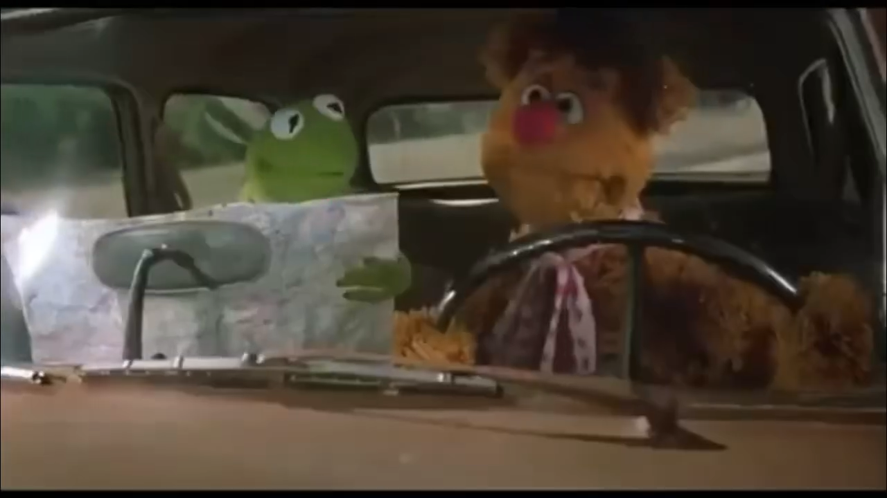

Now my hands have let go, but my heart still reaches.  
I make a map for my mind to follow  
Then burn it in an offering to the gods

<figure>
  
  <figcaption>
    Why don't we take the blue line?... Fozzie, we can't take that, that's a river.
  </figcaption>
</figure>

