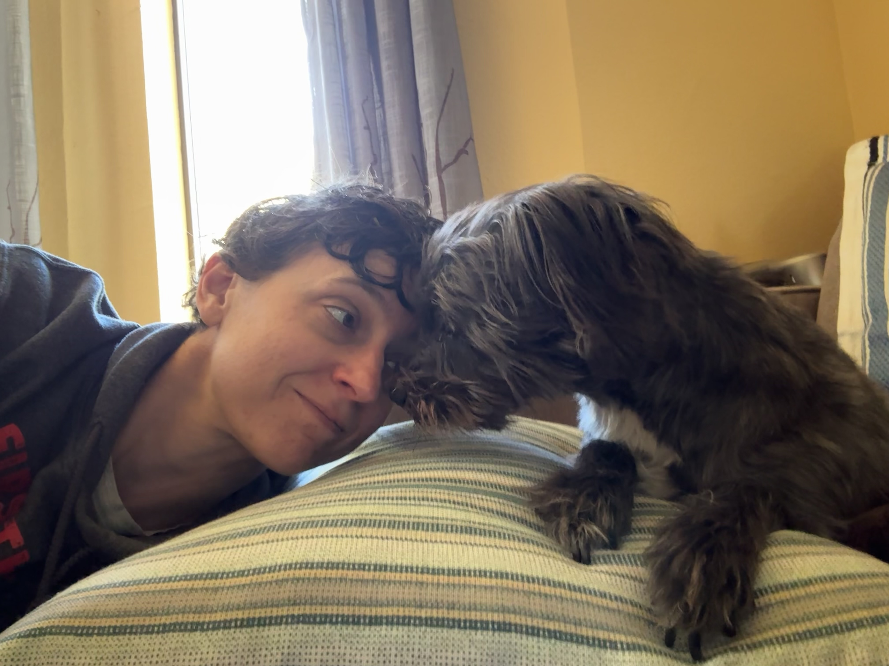

When did the world get so small,  
And the walls that keep the world out cave in?  

Find me a shovel, a winch, and a crowbar  
And I'll pry open my inner door to the universe  

Jump into that vastness without a parachute  
Fall until gravity loses its grip  

Where time and space are suspended  
Free, unconstrained, ill-defined, maleable  

The stars here are free of satellites  
Free of orbiting bodies  

The sky here is without obstruction  
The air here free of sound  

How holy the constraints that freed me

