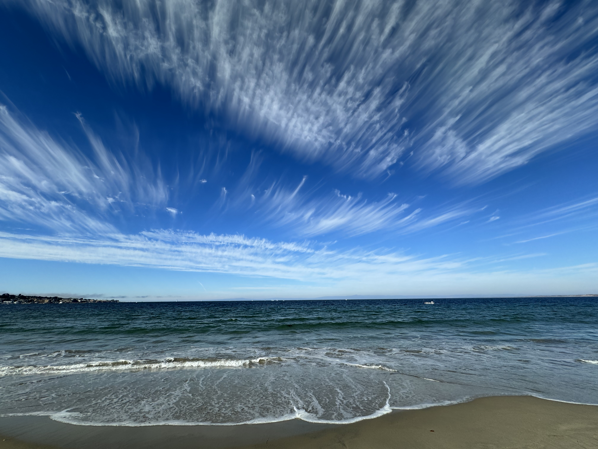

My heart feels heavy tonight. Is it the losses doing their rounds again? Reminding me to grief endlessly? Shall I make gravestones for each? The jobs, the relationships, the abilities, the hobbies, the hopes, the dreams? The lives not lived, the beliefs dashed? I could visit on their anniversaries, lay down flowers, say a prayer. Mysterious to me how these feelings could ever fade, whether fed or starved of my conscious attention. Decades on, I no longer entertain that time heals wounds, but something must, something that travels with time, except when it doesn't. Abandoned and detached, perhaps it was time itself that stood still. Time, not counted in hours or seconds, days or years, but in presence. In units of presence, then, we may still be young, with losses fresh and smarting, forever in need, forever wanting.

