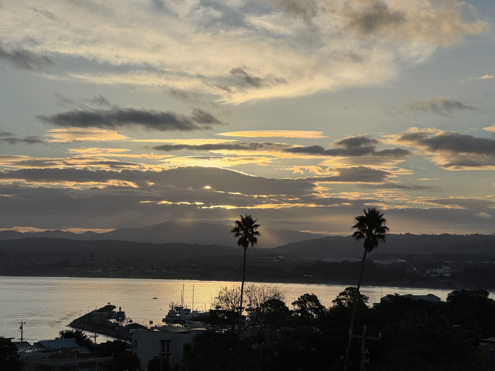

Coffee - top of the list. The biochemist excites my brain. Warm, mild bitterness soothes the pain. Sour and sweet, against my teeth, wearing at the enamel. Better than smoking Camels.

Mist - the dampness in the air. A chill fog rolling off the bay. I watch an errant wisp of fog or cloud drift along its way. I sense a laziness and an urgency to the morning. It's impossible to capture these moments and take them in. Tomorrow I'll try again.

Phils - my pup. She noses my shoulder because "breakfast treats" is plural, and she's only had one. Her wide, innocent eyes belie what is to come. Ferocious barking at the window signals a neighbor passing by, or coming to say hi. Phils knows the assignment. They wave and move along.

