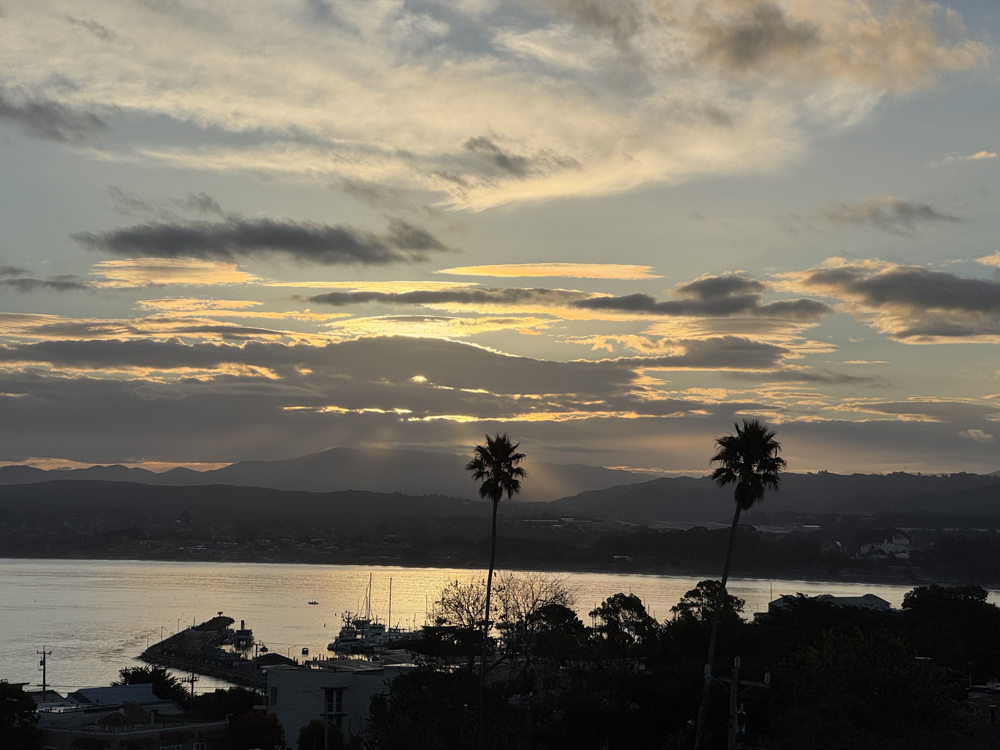

Coffee - top of the list. Its warm, mild bitterness fills my mind. Its sour taste against my teeth, this biochemist extracts the enamel, sure signs I'm an addict.

Mist. There's a dampness in the air and a the chill fog rolling off the bay. I watch an errant wisp of fog or cloud drift along its way. I sense a laziness and an urgency to the morning. It's impossible to capture these moments and them take in. Tomorrow I'll try again.

Phils. My pup noses my shoulder because she is used to breakfast treats - plural... she's only had one. Her wide, innocent eyes belie what is to come. Ferocious barking at the window signals a passing neighbor, coming to say hi. Phils knows the assignment. They wave and move along.

