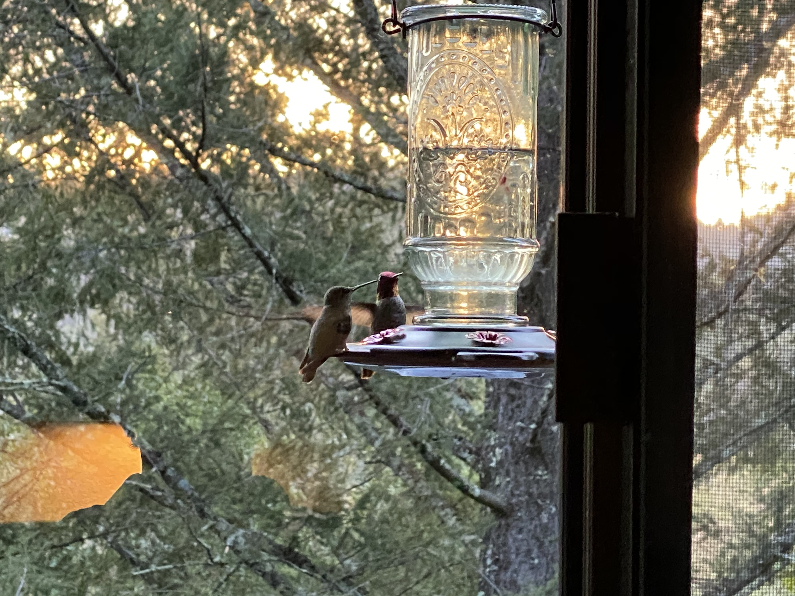

The sun behind the mountain peaks seeks to paint the landscape in my eye. From sleep to waking dream, I die each day a little more. 

The coffee poured, my mind perched to soar, I lift shaky lenses to spy on the bay, not two miles away, but distant nonetheless.

A bird, a plane, a boomerang, what flies across the sea? Gotta love a flying-V! Share the burden of the wind but come back again to tell the tale of your travail because I wonder where and how to be. 

My Uncertainty keeps me in this place, going deeper inside, where in a semi-quiet mind perhaps the answers lie. Or are they lying through their teeth, like a grinning chesire cat who beats my heart's drum, its rhythm a deafening hum? Cease! Decease! What cost to know what's real? Watching endlessly this reel of film before my sight. I crave the night. 

Reset. Resume. Zoom in. We share the burden of the wind. Moments come and go. The coffee is still warm. The sun slips behind a cloud, blessed shroud. Nearby, the hummers zoom and defy what I assume about air and wind and fire. Their colors blaze, their wings a haze of gravity-defying power. When will I give in? Set down my question and furious whim, the emotional crusade against an ignorant blockade, will I know or do I evade Him, Her, Them?

