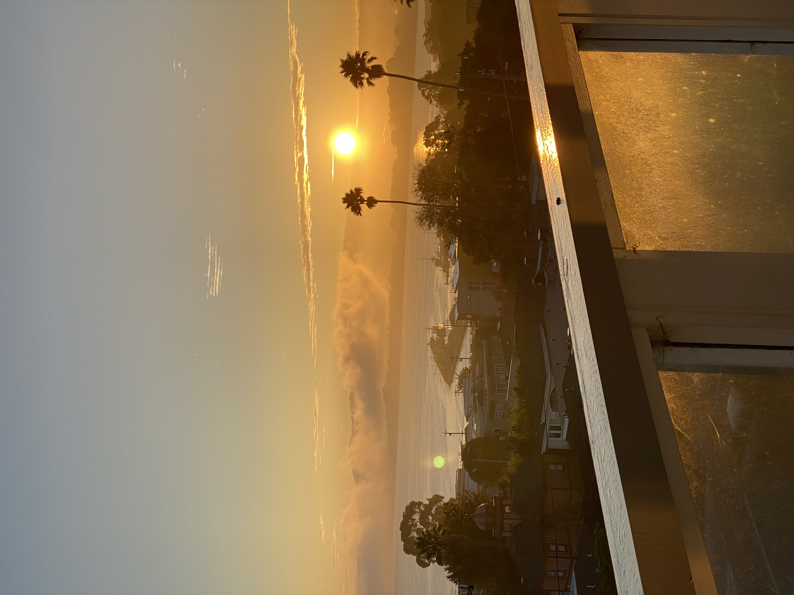

How precious this ignorance, how sacred these demons, that steal back the tools that released me, the objects that bought my freedom. Precious things, reclaimed, never mine to keep. I had clung to my rung on this ladder, afraid to look down, to regress, relinquish what seemed like progress, but no. It was a chain I forged and bound myself to, my own will the cage. And so now my grip releases, and the whoosh of wind is loud, will I drown in this sound or is it oxygen, will I be born again or free at last?

