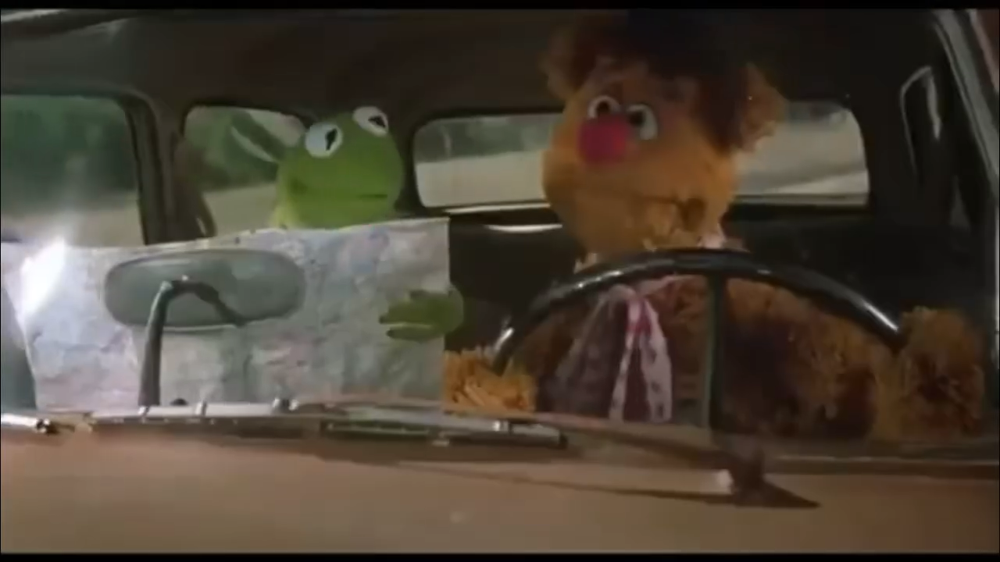

*We can't take that... that's a river*

My hands let go but my heart still reached out, afraid to look down, to go in - a hallow space without structure or walls, or so it seemed. My fight for survival was in vain. The ligaments that stretched out, over-reached, and tore couldn't keep me afloat anymore. And so I fell inward. The grief like water held me in suspense. My eyes stung in the salt and took time to adjust to the dark. Seraphim, with wings to cover their eyes and feet, greet wanderers in this place. Saving grace is gray and grit, an abandoned city revealed, revel here. Hold my beer. I know this place, my true face, one of many that I fear.