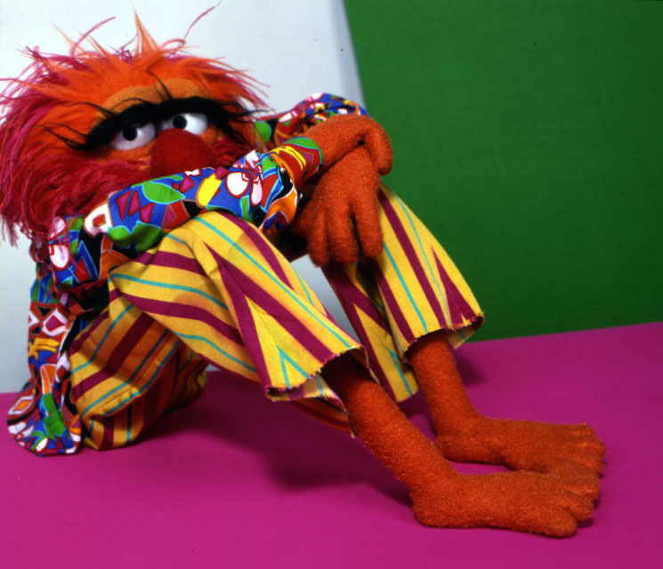

... high on ten hours of sleep, because 6pm is my bedtime when daylight savings time ends. Four hours and a full cup of espresso later, I'm not so sure. 

Do I actually care about this now? What gets through the fog in my brain so thick it could be the setting for The Mist? Like an emerging monster, I resurrected myself from Stephen King's Pet Sematary, as one of its feral cats without memory of my past life, my soul yet unclaimed in some Lost and Found. Fuck this unholy burial ground.

I'll leave this here for now, a place I can revisit and explore The Silo, daring myself to the surface each day to clean the window.

---

Popping in briefly, some 18 hours later, up at 1am, drinking oat milk to make up a calorie deficit, running low for a couple days. Tricky thing, eating. Relentless. Some days I just don’t have the energy for it. And eating the wrong thing will close my throat for days. I do enjoy the high of an untethered nervous system, leaving my physical body and flying off into the stars. That was an early name for autistic children - the children of the stars. I can stare at the ceiling, at the wall, for minutes, hours even, when the conditions are right. 

I do try to stay grounded, to create a safe enough space in my own body for my conscious mind to reside here. I’ve only recently taken possession of it. Somehow this body hadn’t been mine to fully inhabit before, so it’s taking time to figure out. I’m not used to feeling free to dress it and move in it the way I want. It still feels wrong, like I’m breaking every cryptic rule that took ages to decode in the first place. I was - still am? - so willing to trade this body for the thing I need the most - a buffer between my inner world and the regular one. And I definitely made that trade in the past. Autonomy was my bargaining chip. Reclaiming it came at a pretty steep cost. It feels like I’m still paying it and reckoning is the interest payment.

So interesting what causes my throat to close up - the wrong food in, the wrong words out. 

---

Our deepest wounds are easily reburied in the sunlight. The voices in this shame game don a legitimacy when the veil between the worlds thickens again. This game of chicken, right? Well, fuck it. I know I'm wrong. Those early doubts of my instincts, my natural way of being, hardened into beliefs and I sought out those harsh, suffocating boundaries in my lovers. The cure for gender confusion and lesbianism is well known in our collective subconscious. My struggle to focus, to stay on task, to read the room, to control my impulses and over-excitability, could all be explained by the inferiority of my sex. My unspoken autistic needs needed to be compensated. The cost of care paid in a familiar currency, one carved into our evolving DNA and collective memory.

I can feel the rawness of the details in my heart and in my gut, in my mother loving cunt, but they won't percolate past my jaw. I did this to myself.

---

*Autistic burnout is a state of profound physical, mental, and emotional exhaustion caused by prolonged stress, chronic sensory and social overwhelm, and the cumulative demands of navigating a world that is not designed to accommodate autistic needs.*

*It is often characterized by a loss of previously accessible skills, reduced capacity to manage everyday responsibilities, increased sensory sensitivities, and a diminished ability to cope with demands.*

*Unlike ordinary exhaustion, autistic burnout is not typically resolved through a few days of rest. 
Recovery often requires sustained reductions in demands, increased accommodations, and meaningful changes to the circumstances that contributed to burnout.*

I gave up leaving the house a month ago. The predictability and ease of living alone unlocked something within me and I started to write. My self-expression felt alien and I watched it with a kind of disgusted fascination. But now the isolation and dissociation are bringing me right up to that familiar destructive edge, wanting to get higher on adrenaline and pure impulse. Makes total sense in retrospect why I was so willing to give up bodily autonomy for support. These unnamed neurodivergent needs played right into the conservative prejudices I grew up in. The self-doubt hardened into beliefs in my wrongness in every category and sought corrective forces in my relationships, people who could keep my natural ways of being in check. I'm unleashed in all ways now, good and bad, for better or for worse. 

---

The world's a stage, right? I think so. I remember the players I performed, the ones I carefully crafted and grew to love. And they were lovable. They didn't carry any baggage or suffer any drama. No slings and arrows of outrageous fortune touched them. Simple, deep in purely productive ways.

As I watch these players fade into The Mist, being devoured, presumably, by dragons, I can't imagine who is left. There are pieces strewn about that my two hands try to work into some three dimensional shape, but it's not quite working.
