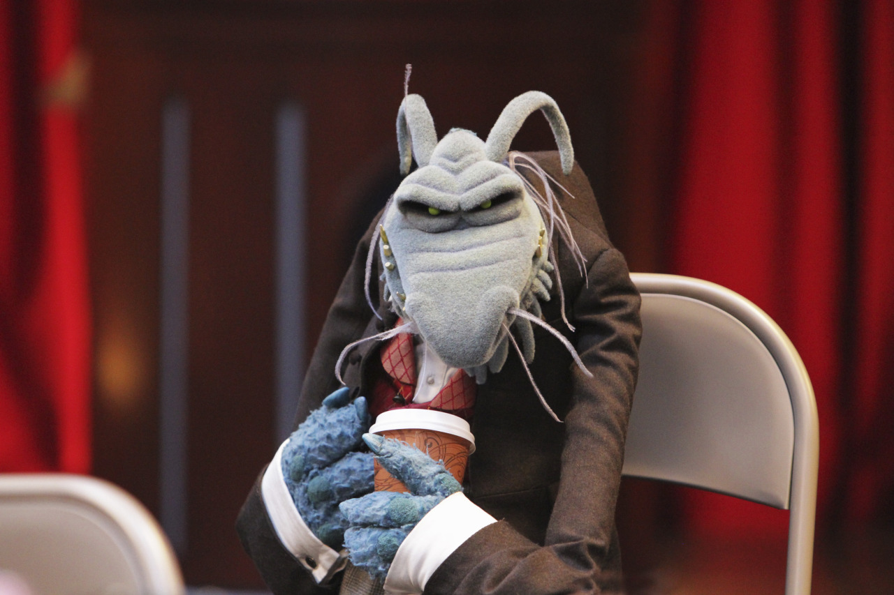

The world's a stage, right? I think so. I remember the players I performed, the ones I carefully crafted and grew to love. And they were lovable. They didn't carry any baggage or suffer any drama. No slings and arrows of outrageous fortune touched them. Simple, deep in purely productive ways.

As I watch these players fade into The Mist, being devoured, presumably, by dragons, I can't imagine who is left. There are pieces strewn about that my two hands try to work into some three dimensional shape, but it's not quite working.